<!-- 🌸 Header -->

<!-- ✏️ Replace YOUR-LINKEDIN and you@email.com with your real info -->

  

## 🌷 About Me

I'm **Mika**, a Full Stack Web Development student at **RRC Polytech** in Winnipeg, originally from **Chile** 🇨🇱.
I love building things that come from real life: a recipe book my family couldn't share across countries, a parking problem everyone jokes about. That's where my best projects start.

- 🗄️ **Strongest at:** backend development, database design & software architecture
- 💻 Passionate about clean code and **SOLID principles**
- 🎨 Learning graphic design in Canva, because good code deserves good design
- 🗣️ Bilingual: **Spanish** (native) & **English**
- 🏋️‍♀️ Off the terminal: the gym, creative projects, enjoying life & my kitten 🐱

 

## 💼 Why Work With Me

<table>
<tr>
<td width="33%" valign="top" align="center">

### 🧩
**Problem first** 
I build from real needs, then pick the right architecture for them.

</td>
<td width="33%" valign="top" align="center">

### 🗄️
**Backend & data minded** 
Normalized schemas, secure auth, role-based access and clean MVC.

</td>
<td width="33%" valign="top" align="center">

### 🌎
**Adaptable** 
I moved countries and learned a new language. New tech stacks don't scare me.

</td>
</tr>
</table>

## 🎀 Tech Stack

**Languages & Frameworks**

**Backend, Databases & DevOps**

**Design**

## 💖 What I'm Building Right Now

<table>
<tr>
<td width="50%" valign="top">

### 📖 [Heritage Kitchen](https://github.com/mmera21/heritage-kitchen)
When I moved to Canada, I couldn't bring my family's recipe book (my aunt was still using it!) and recipe photos kept getting lost in WhatsApp chats. So I built a **digital family cookbook**:

- 👩‍🍳 **Chef** role to add dishes · 👀 **Viewer** role to browse
- 🏡 Each family has its own category for **inherited recipes**
- ✈️ Relatives living far away can add the new dishes they discover
- 🔁 Designed to adapt to **any family**

</td>
<td width="50%" valign="top">

### 🚗 [NidoPark](https://github.com/mmera21/NidoPark)
It started as a joke about Winnipeg's downtown parking prices. My roommates and I had a driveway and no cars. **NidoPark is like Airbnb, but for parking**:

- 🅿️ Rent a private spot by the month, safer than street parking
- 💸 Homeowners earn **extra income** from unused space
- 🏙️ Helps apartment dwellers and two-car households
- ⚖️ Also my way to study the **legal side** of sharing-economy businesses

</td>
</tr>
</table>

🌱 <b>More from school</b>

 

- ⚛️ [React + Docker app](https://github.com/mmera21/coding-assigment11): containerized React project
- 🟦 [TypeScript project](https://github.com/mmera21/coding-assigment12)
- 💎 [OO Ruby Challenges](https://github.com/mmera21/OO-Ruby-Challenges): object-oriented challenges with tests

## 📈 GitHub Activity

### 🌸 My Mantra

*"Don't waste your life worrying about getting it wrong. Just do it, and never be left wondering."*

 

**💌 Looking for a Winter 2027 co-op student? Let's talk!**

